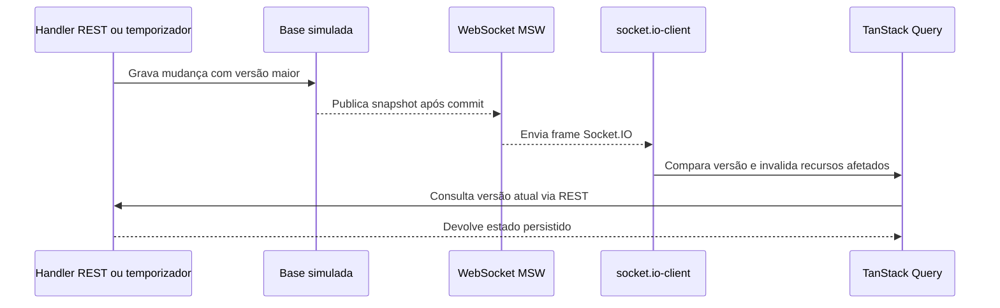

# Eventos em tempo real

A aplicação usa `socket.io-client` com WebSocket na rota de transporte `/kurio-realtime/`. No modo simulado, o handler do MSW fala Engine.IO v4 e Socket.IO v5. O módulo do cliente é carregado depois que a interceptação foi iniciada. [Serviço Socket.IO](../src/services/socket.ts) · [Handler MSW](../src/mocks/handlers/socket.ts)

## Contratos

| Evento          | Escopo                                        | Recursos atualizados                                   |
| --------------- | --------------------------------------------- | ------------------------------------------------------ |
| `nft.updated`   | Público                                       | Catálogo, detalhe, carrinho e cotação                  |
| `order.updated` | Privado, com `session: { userId, sessionId }` | Estado do pedido e consultas de carrinho e cotação     |
| `mock.probe`    | Diagnóstico do transporte                     | Usa o mesmo cliente para ler um NFT da base persistida |

Os dois eventos de negócio têm `id`, `resourceId`, `version` e `resource`. O ID do evento segue o formato `nome:recurso:versão`. O evento leva um snapshot do recurso. Para pedidos, esse snapshot sinaliza uma mudança e a interface usa a resposta REST para apresentar o resultado. Os contratos TypeScript estão em [api.ts](../src/types/api.ts).

O namespace recebe `sessionId` no handshake Socket.IO. O mock valida se a sessão pertence ao visitante atual e confere se ela continua ativa antes de publicar um pedido. O cliente confere usuário e ID de sessão antes de invalidar qualquer consulta privada. A troca de sessão aborta o ciclo de vida anterior, remove listeners e desconecta o socket.

## Publicação e reconciliação



- **NFT** — o cliente aplica uma versão mais nova ao detalhe em cache, cancela leituras anteriores e invalida o catálogo. A cotação antiga é marcada como desatualizada. O carrinho é atualizado pela API e a versão corrente determina qual cotação consultar.
- **Pedido** — o evento cancela e invalida a consulta do pedido. A interface renderiza estado e recibo a partir do REST e preserva estados terminais. A consulta de pedidos pendentes também é invalidada, permitindo retomar sem criar outra compra.
- **Reconexão** — o cliente Socket.IO repete a conexão com espera entre 500 ms e 2 s. Ao conectar, reconcilia consultas ativas. Um pedido pendente também pode ser consultado manualmente ou aguardado pela consulta periódica. O mock calcula o resultado mesmo durante a interrupção do socket e pode resolver o prazo via REST após refresh.
- **Duplicatas e atraso** — as versões mais altas observadas são mantidas por NFT e por pedido da sessão. Eventos com versão menor ou igual não disparam alterações. Consultas tardias sobre versões menores são rejeitadas ou preservam o snapshot mais recente no cache. O cliente cancela as consultas do catálogo anteriores ao evento para evitar resultados de filtros e páginas que já ficaram desatualizados.

## Reproduzir no navegador

Ative o modo demo e use os comandos abaixo no console. Na troca de cenário, recarregue para reiniciar o histórico de versões e o cache do aplicativo. Veja as credenciais em [cenários](scenarios.md).

1. **Preço no checkout** — adicione uma unidade de Raposa Âmbar, entre como Ana, conecte a carteira fictícia e confirme os valores da cotação no checkout. Execute:

   ```js
   await window.kurioMocks.http.patch(
     "/__mock/nfts/exemplo/editions/standard",
     {
       price: "0.09",
     },
   );
   ```

   A revisão anterior perde a validade. Confira o aviso, a nova cotação e o envio desativado até confirmar os novos valores.

2. **Disponibilidade e esgotamento** — envie `{ available: 1 }` ou `{ available: 0 }` para o mesmo endpoint. A quantidade indisponível bloqueia a cotação. Ajuste ou remova a linha antes de seguir.
3. **Duplicata e evento antigo** — após mudar o NFT, repita o comando abaixo com `duplicate` e `older`. Os frames chegam pelo socket, e o preço e a versão não regridem.

   ```js
   await window.kurioMocks.http.post("/__mock/realtime/replay", {
     nftId: "exemplo",
     kind: "older",
   });
   ```

4. **Pedido, desconexão e reconexão** — após revisar e enviar um pedido, interrompa o socket enquanto o pedido estiver pendente com `POST /__mock/realtime/disconnect`. Avance o relógio com `await window.kurioMocks.advanceClock(2000)`. Reative com `POST /__mock/realtime/reconnect`. O cliente reconecta por conta própria e busca o status REST. Recarregar a URL do pedido também consulta o mesmo ID.
5. **Recusa e troca de conta** — selecione `order-declined`, autentique novamente e faça o pedido. A recusa volta ao REST sem recibo e mantém os itens. Saia e entre como Bruno. O pedido anterior não pode ser consultado nem recebido pela nova sessão.

Para interromper o transporte antes de criar o pedido, execute o comando de desconexão no checkout e depois envie o pedido. REST continua disponível. Após o envio, a página de status pode recuperar o resultado pela reconciliação ou pela consulta periódica.

O endpoint `GET /__mock/realtime/status` informa se o transporte aceita conexões e quantos clientes concluíram o handshake. Os testes usam essa leitura para confirmar a conexão e a recuperação.

## Limitações

O mock cobre WebSocket, namespace raiz, handshake, ping/pong, desconexão e eventos de texto. Polling, binários, acknowledgements, namespaces personalizados e replay automático de mensagens perdidas ficam fora do recorte. Os controles e o histórico de replay vivem na página. Mudanças persistidas por outra aba podem ser recuperadas por leitura REST. Referências do protocolo estão na documentação oficial. [Engine.IO](https://socket.io/docs/v4/engine-io-protocol/) · [Socket.IO](https://socket.io/docs/v4/socket-io-protocol/)

Os testes locais em Node usaram a distribuição oficial Socket.IO Client 4.8.1 presente no cache, com MSW 2.13.3. A instalação da versão declarada no projeto e a verificação no navegador e no build demo ficaram pendentes devido ao acesso ao registro npm.
