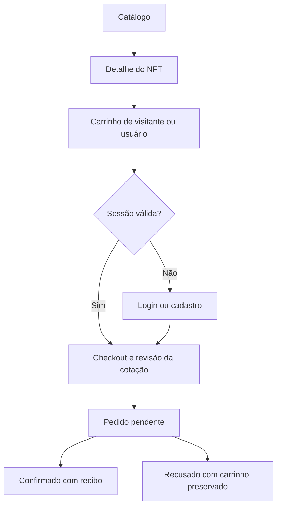
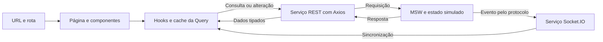

# 01. Visão geral do KURIO

Imagine que você encontrou uma obra no catálogo, escolheu uma edição e a colocou no carrinho. Durante o pagamento, o preço mudou. O KURIO precisa mostrar o novo valor e pedir sua confirmação novamente. Esse caso reúne vários assuntos do projeto, da interface ao tratamento de dados que mudam enquanto a página está aberta.

O KURIO é um marketplace simulado de NFTs, itens digitais identificáveis que podem ter edições e disponibilidade próprias. O projeto serve como entrega de um desafio frontend júnior e como exercício de construção de um aplicativo completo. Carteiras, transações e pagamentos são simulados no navegador.

Este guia descreve as camadas e os fluxos implementados no código. Consulte o [checklist](../challenge-checklist.md) para a situação das verificações e da publicação. O [enunciado](../reference/challenge.md) define os comportamentos e a [referência visual](../reference/design.webp) mostra a composição das telas.

## O que o usuário pode fazer

- **Descobrir** — navegar pelos destaques, buscar, combinar filtros, ordenar e paginar. A URL guarda esses parâmetros, permitindo voltar à mesma busca depois de recarregar a página.
- **Escolher** — abrir um NFT, ver a galeria, selecionar uma edição disponível e definir a quantidade. O usuário autenticado pode salvar favoritos.
- **Comprar** — montar o carrinho como visitante, alterar quantidades, aplicar cupom e continuar após o login. No checkout, selecionar e conectar uma carteira fictícia, escolher a rede, revisar cotação e enviar. Se o pedido ficar pendente, é possível recuperar seu estado depois.
- **Gerenciar a conta** — cadastrar-se, entrar, sair, editar perfil, avatar e senha, além de cadastrar ou editar as carteiras principal e secundária.

O checkout exige sessão. Quando ela expirar, o usuário pode entrar novamente e retomar o fluxo. A simulação tem três estados de pedido. O recibo exibe os valores registrados no pedido confirmado, mesmo se o catálogo mudar depois.

A identidade visual combina marrom escuro, ações em laranja e imagens em destaque. No desktop, filtros ficam na lateral e login e cadastro abrem em diálogos. No mobile, os filtros são recolhíveis e a autenticação usa páginas dedicadas. A referência também orienta a adaptação para tablet e para telas mobile sem frame próprio.

## Para que serve cada tecnologia

| Tecnologia      | Papel no KURIO                                                                                                               |
| --------------- | ---------------------------------------------------------------------------------------------------------------------------- |
| React           | Renderiza as telas com componentes reaproveitáveis, como os cards do catálogo.                                               |
| TypeScript      | Verifica os tipos usados nos componentes e nos contratos, ajudando a encontrar incompatibilidades antes da execução.         |
| TanStack Router | Define quais telas abrir, valida filtros da URL e protege rotas privadas.                                                    |
| TanStack Query  | Gerencia consultas, operações que alteram dados e cache. Também decide quando buscar dados novamente.                        |
| Axios           | Envia as requisições HTTP, recebe as respostas e permite cancelar buscas antigas.                                            |
| REST APIs       | Definem as operações e formatos de dados para listar NFTs, editar o carrinho, cotar e buscar pedidos, entre outros recursos. |
| Socket.IO       | Entrega avisos de mudança de preço, estoque e pedido enquanto a página está aberta.                                          |
| MSW             | Intercepta a comunicação da aplicação no ambiente simulado. Os handlers de REST e de Socket.IO usam o mesmo estado.          |
| Tailwind CSS    | Aplica a identidade visual e ajusta o layout para diferentes larguras.                                                       |
| shadcn/ui       | Oferece a composição local adaptada ao tema, como Card e Button.                                                             |
| Playwright      | Opera o navegador como um usuário para verificar fluxos e comparar capturas de tela.                                         |
| Lighthouse      | Audita o build otimizado em desempenho, acessibilidade, boas práticas e SEO.                                                 |

| Ferramenta complementar | Papel no KURIO                                                                                       |
| ----------------------- | ---------------------------------------------------------------------------------------------------- |
| Vite e npm              | Servir o projeto durante o desenvolvimento, gerar o build e gerenciar versões de dependências.       |
| React Hook Form e Zod   | Gerenciar campos e erros dos formulários e validar dados com regras explícitas.                      |
| Decimal.js              | Calcular valores em ETH a partir de strings decimais, preservando a precisão definida pelo contrato. |
| ESLint e Prettier       | Verificar regras de código e padronizar a formatação, respectivamente.                               |

## Como as partes conversam

Ao mudar um filtro, a rota atualiza a URL e a página passa os parâmetros ao hook de catálogo. O hook usa TanStack Query para consultar dados com uma chave que inclui os filtros. O serviço usa Axios para enviar a requisição REST. O MSW responde com dados do cenário escolhido e a página renderiza o resultado armazenado pela Query.

Uma alteração de estoque começa no estado da simulação. O handler emite um evento que chega pelo cliente Socket.IO. A aplicação verifica se o recurso e a versão ainda correspondem ao estado atual e sincroniza as consultas afetadas. Se houver uma desconexão, a reconexão dispara uma consulta REST para buscar o estado atual.

## Onde cada parte fica

A tabela mostra onde encontrar as partes implementadas. A organização completa está no [Steering de estrutura](../../.kiro/steering/structure.md).

| Diretório                    | O que procurar                                                                                                                           |
| ---------------------------- | ---------------------------------------------------------------------------------------------------------------------------------------- |
| `src/components`             | Peças reutilizáveis, com `ui` para shadcn/ui, `layout` para a estrutura compartilhada e `common` para elementos usados por várias telas. |
| `src/pages`                  | Composição e componentes específicos de cada tela.                                                                                       |
| `src/routes`                 | Caminhos, parâmetros de busca e proteção de acesso.                                                                                      |
| `src/hooks`                  | Consultas, atualizações e comportamentos reaproveitáveis.                                                                                |
| `src/contexts`               | Reservado para estado global adicional. O código atual concentra sessão e dados remotos na Query e dispensa esse diretório.              |
| `src/services`               | Integração de rede com Axios e Socket.IO.                                                                                                |
| `src/mocks`                  | Handlers do MSW, dados iniciais dos cenários e regras da simulação.                                                                      |
| `src/types`                  | Tipos e formatos compartilhados entre as partes.                                                                                         |
| `src/lib`                    | Configurações e utilitários pequenos.                                                                                                    |
| `src/assets`                 | Imagens, fontes e outros recursos visuais.                                                                                               |
| `src/styles`                 | Estilos globais e variáveis da identidade visual.                                                                                        |
| `tests/e2e` e `tests/visual` | Specs de fluxos completos e de regressão visual. As baselines aguardam execução em navegador.                                            |
| `docs/study`                 | Roteiro e guias que acompanham a implementação.                                                                                          |

## Sequência de desenvolvimento

1. Definir contexto e critérios. Em seguida, montar a base do projeto e a identidade visual.
2. Definir contratos REST e cenários do MSW. Testar cedo se o cliente Socket.IO consegue receber eventos pelo mock.
3. Construir home, catálogo e detalhe. Depois, implementar sessão, perfil, carteiras e favoritos.
4. Montar carrinho e cotação, implementar checkout e recuperação de pedidos e ligar os eventos aos fluxos prontos.
5. Revisar responsividade e acessibilidade, completar os testes Playwright, medir com Lighthouse e verificar o deploy público.

O [plano de implementação](../implementation-plan.md) detalha as 15 etapas e seus critérios de aceite. O [Steering técnico](../../.kiro/steering/tech.md) registra as regras de integração, e o [Steering de qualidade](../../.kiro/steering/quality.md) reúne as verificações exigidas.

## Erros comuns

- Duplicar filtros em estado local e na URL. Ao usar o histórico, é fácil restaurar apenas um deles. Use a URL como referência para os filtros aplicados.
- Gerar uma nova chave ao repetir um pedido após timeout. O pedido anterior pode já existir. Reutilize a chave e o conteúdo da mesma tentativa.
- Usar `number` para somar preços em ETH. A aritmética de ponto flutuante pode introduzir diferenças. Preserve as strings no transporte e use Decimal.js nos cálculos.

## Exercícios

1. Percorra o diagrama de compra assumindo que a sessão expirou antes do checkout. Indique onde ocorre o login e em que ponto o usuário volta à revisão. O carrinho deve continuar disponível.
2. Use o diagrama de camadas para localizar onde entrariam uma resposta REST de estoque indisponível e um aviso de mudança de estoque. Os dois caminhos devem partir do estado simulado e refletir o mesmo estoque.

## Perguntas de entrevista

1. **Por que guardar filtros na URL?** Para recarregar, compartilhar e voltar à mesma seleção pelo histórico. A lista pode ser consultada a partir dos parâmetros da rota.
2. **Qual a diferença entre Axios e TanStack Query?** Axios executa a chamada HTTP. Query controla quando consultar, o que fica em cache e quais dados precisam ser atualizados.
3. **O que o MSW permite testar?** Ele responde às chamadas de rede da aplicação. Assim, uma falha simulada percorre o mesmo caminho de uma resposta normal e exercita os estados de erro e recuperação da interface.
4. **Como evitar que um timeout duplique uma compra?** Reenvie a mesma chave de idempotência com o mesmo conteúdo. A simulação busca o pedido que já foi registrado ou cria um único pedido se a tentativa ainda não existir.
5. **Como impedir que um evento atrasado reverta um pedido confirmado?** Verifique a sessão e compare a versão recebida com a versão atual. Descarte eventos antigos e preserve os estados terminais, como confirmado e recusado.
