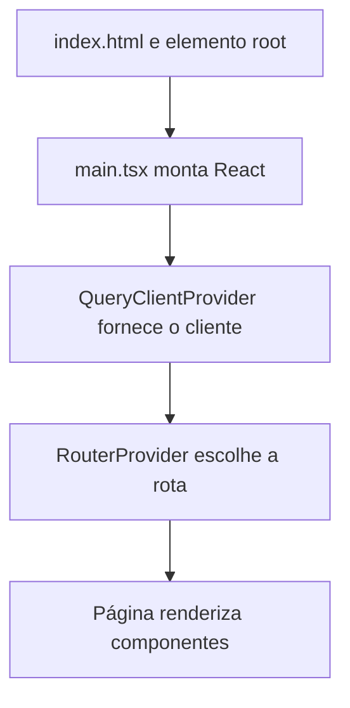

# 02. React e TypeScript

O KURIO reutiliza componentes para apresentar conteúdo e feedback em várias telas. React combina essas peças. TypeScript verifica os dados que cada peça recebe.

## Componentes, props, estado e hooks

Um componente React é uma função que descreve uma parte da tela. A função recebe dados de entrada, chamados **props**, e retorna elementos. Estado vazio recebe título, descrição opcional e espaço para ações. Este trecho abrevia os demais campos do tipo. [Componente EmptyState](../../src/components/common/empty-state.tsx)

```tsx
type EmptyStateExample = {
  title: string;
  description?: string;
};
```

O ponto de interrogação torna a descrição opcional. Passar um número em `title` gera um erro de tipo. A verificação roda com `npm run typecheck` e também faz parte do build. O modo `strict` reforça verificações como a de valores que podem estar ausentes. [Configuração TypeScript](../../tsconfig.json)

**State** é um valor que o React preserva entre renderizações. Quando você atualiza esse valor com o setter de `useState`, o React pode renderizar o componente novamente. Um painel que abre e fecha é um exemplo de estado local. A galeria guarda o identificador da imagem em estado local, e o EmptyState exibe as props diretamente.

**Hooks** são funções usadas por componentes para acessar recursos como estado ou contexto. O detalhe usa `nftRoute.useParams()` para obter o identificador mantido pelo roteador. Chame hooks no nível superior do componente, fora de condições e loops. [Árvore de rotas](../../src/routes/router.tsx)

## JSX, TSX e Vite

JSX é a sintaxe parecida com HTML usada para descrever a interface no JavaScript. Em arquivos TypeScript que contêm JSX, usamos a extensão `.tsx`. As chaves no trecho do projeto inserem valores e expressões na descrição da tela. [Componente EmptyState](../../src/components/common/empty-state.tsx)

```tsx
{
  description && <p className="text-muted-foreground">{description}</p>;
}
```

O Vite serve os arquivos durante o desenvolvimento e transforma TSX para o navegador. Seu build produz os arquivos estáticos de produção. O TypeScript faz a checagem de tipos separadamente. O alias `@/` é registrado tanto no Vite quanto no TypeScript e permite importar a partir de `src/`. [Configuração Vite](../../vite.config.ts)

## Como a aplicação começa

O `index.html` contém o elemento `#root` e carrega `src/main.tsx`. Esse módulo localiza o elemento, importa o CSS global e monta o React. Se o elemento estiver ausente, a inicialização falha com uma mensagem clara. [HTML de entrada](../../index.html) e [ponto de entrada React](../../src/main.tsx)

```tsx
root.render(
  <StrictMode>
    <QueryClientProvider client={queryClient}>
      <RouterProvider router={router} />
    </QueryClientProvider>
  </StrictMode>,
);
```

O `StrictMode` ativa verificações extras em desenvolvimento. O `QueryClientProvider` dá às telas acesso ao cliente que manterá o cache compartilhado. O `RouterProvider` usa o roteador para escolher qual tela renderizar. O `queryClient` é criado em módulo próprio, fora da renderização, para preservar uma única instância. [Cliente de consultas](../../src/lib/query-client.ts)



## Erros comuns e prática

- Criar o cliente de consultas no corpo de um componente pode recriar o cache quando ele renderizar novamente. Mantenha a instância compartilhada fora da renderização.
- Copiar props para estado local sem necessidade cria dois valores que podem divergir. Renderize diretamente o valor recebido quando ele só precisa ser exibido.

1. No estado vazio do carrinho, altere o texto passado para `title`. Observe a atualização no navegador e depois reverta.
2. Passe um número para `title` e rode `npm run typecheck`. Confira o erro, restaure a string e rode o comando novamente.

## Perguntas de entrevista

1. **Qual a diferença entre props e state?** Props são entradas dadas pelo componente que renderiza outro. State é memória da própria instância, atualizada por um setter.
2. **Por que as telas usam a extensão TSX?** Ela indica que o arquivo contém TypeScript e JSX, como na descrição do `EmptyState`.
3. **Por que o build do Vite roda o TypeScript antes?** Transformar a sintaxe para JavaScript e verificar tipos são passos distintos. O script exige que os dois sejam bem-sucedidos.
4. **Para que serve um provider?** Ele disponibiliza um valor a descendentes. No KURIO, um provider entrega o cliente de consultas e outro integra o roteador.
5. **Por que chamar sempre os mesmos hooks na mesma ordem?** O React mantém informações de cada chamada pela ordem de execução. Uma chamada condicional pode quebrar essa associação.
