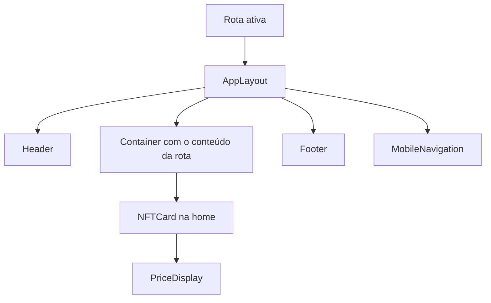

# 03. Componentes e estilos

O card de NFT, o cabeçalho e o seletor de quantidade resolvem problemas diferentes. Separá-los em componentes permite mudar a aparência em um lugar e reutilizar as mesmas regras visuais em várias telas.

## Props e composição

Props são os valores que um componente recebe. `NFTCard` recebe nome, imagem e preço. A imagem traz uma descrição alternativa. O preço chega como string e `PriceDisplay` troca o separador decimal para exibir o valor em português, preservando todos os dígitos. O componente também aceita `children`, que permite à tela inserir conteúdo dentro do card. [Card de NFT](../../src/components/common/nft-card.tsx) e [exibição de preço](../../src/components/common/price-display.tsx)

No detalhe, a página passa `nft.gallery` para `NFTGallery` e `nft.editions` para `NFTEditionPanel`. A galeria guarda apenas o ID da imagem selecionada. O painel guarda o ID da edição e a quantidade solicitada. A imagem, a edição, o preço e a quantidade válida são **estado derivado**, calculado com os dados mais recentes da API e a seleção local. [Página de detalhe](../../src/pages/nft-detail-page.tsx), [galeria](../../src/pages/nft-detail/nft-gallery.tsx) e [painel de edições](../../src/pages/nft-detail/nft-editions.tsx)

```ts
const available = edition?.available ?? 0;
const quantity = boundedQuantity(selection.requested, available);
```

O [seletor compartilhado](../../src/components/common/quantity-selector.tsx) recebe a quantidade, o máximo e a função de alteração por props. Esse é um exemplo de **componente controlado**. A função [boundedQuantity](../../src/pages/nft-detail/quantity.ts) retorna um inteiro entre 1 e o estoque. Para edição esgotada, retorna zero, e a tela desativa o seletor. Ao trocar de edição, o painel reinicia o pedido de quantidade em 1. Se o estoque diminuir após uma consulta, a quantidade exibida respeita o novo limite e a tela informa a redução.

**Renderização condicional** é decidir o que mostrar a partir de um valor. O detalhe mostra o skeleton enquanto espera, um estado vazio para 404 e um erro com nova tentativa para falha de rede. Quando há dados, ele monta a galeria e as edições com as props recebidas.

O layout recebe o conteúdo das rotas em `children`. Essa composição permite que os mesmos cabeçalho, rodapé e contêiner envolvam páginas diferentes. [Layout](../../src/components/layout/app-layout.tsx) e [rotas](../../src/routes/router.tsx)



## Tailwind, shadcn/ui e variáveis CSS

Tailwind transforma classes utilitárias em CSS. Em vez de criar uma classe exclusiva para cada card, usamos utilitários como `rounded-panel`, `bg-card` e `text-card-foreground`. Componentes shadcn/ui ficam no código do projeto para que possamos adaptá-los. Aqui, Card e Button recebem classes do tema e usam `cn` para combinar classes padrão e personalizadas. [Card](../../src/components/ui/card.tsx), [Button](../../src/components/ui/button.tsx), [função cn](../../src/lib/utils.ts) e [configuração shadcn/ui](../../components.json)

As variáveis em `:root` guardam os valores CSS do tema. O bloco `@theme inline` associa esses valores aos nomes de utilitários. Estas são duas das associações usadas no projeto. [Estilos globais](../../src/styles/globals.css)

```css
--color-card: var(--card);
--color-card-foreground: var(--card-foreground);
```

Para modificar o tema, ajuste os valores de `--card`, `--primary` ou `--font-heading` em `:root`. Confira o resultado no navegador, incluindo contraste do texto, estado hover e foco de teclado. O [resumo de arquitetura](../../ARCHITECTURE.md) explica a origem das cores e a substituição da arte.

## Responsividade e estados visuais

O layout começa pela tela estreita. Na navegação inferior, `md:hidden` esconde a barra a partir de `48rem`, geralmente 768 px. No cabeçalho, a combinação `hidden md:flex` faz o inverso. O `Container` limita a largura em telas grandes e usa margens internas fluidas para manter o texto longe das bordas. [Navegação mobile](../../src/components/layout/mobile-navigation.tsx), [cabeçalho](../../src/components/layout/header.tsx) e [contêiner](../../src/components/layout/container.tsx)

Um **skeleton** ocupa espaço enquanto o conteúdo carrega. O tamanho é informado pela tela, de modo que ela possa reservar espaço semelhante ao componente final. O brilho em movimento, ou _shimmer_, só é ativado quando o usuário não pediu movimento reduzido. A forma continua visível e o rótulo de carregamento é anunciado por um leitor de tela. O roteador já configura esses componentes como estados de carregamento, erro e rota desconhecida. [Skeleton](../../src/components/common/loading-skeleton.tsx), [estado vazio](../../src/components/common/empty-state.tsx), [estado de erro](../../src/components/common/error-state.tsx) e [rotas](../../src/routes/router.tsx)

## Reflow, foco e mensagens acessíveis

Quando o zoom deixa menos espaço horizontal, o [grid de NFTs](../../src/components/common/nft-grid.tsx) passa para uma coluna abaixo de `22rem`. Isso dá espaço à imagem, ao título e ao botão de favorito. O [CSS global](../../src/styles/globals.css) permite quebrar palavras longas e mantém o contorno de foco. Campos podem encolher dentro de grids, evitando que o tamanho intrínseco de um select alargue a página.

A [barra mobile](../../src/components/layout/mobile-navigation.tsx) reserva espaço no fim da página. A variável também orienta a área de rolagem, reduzindo o risco de um campo focado ficar atrás da barra. Com pouca altura, como em algumas combinações de zoom e orientação, a barra volta ao fluxo normal. [CSS global](../../src/styles/globals.css) e [layout](../../src/components/layout/app-layout.tsx)

```css
html {
  scroll-padding-bottom: calc(var(--navigation-clearance) + 0.75rem);
}
```

O layout move o foco para o conteúdo ao trocar de rota. Aplicar filtros na mesma rota preserva o foco atual. Diálogos e drawers usam a semântica nativa e devolvem o foco quando são fechados. Se o drawer for fechado pela mudança para a largura desktop, o título do catálogo recebe o foco. [Layout](../../src/components/layout/app-layout.tsx), [drawer](../../src/pages/home/catalog-filters.tsx) e [login em diálogo](../../src/components/auth/auth-dialog.tsx)

No [campo de cupom](../../src/pages/cart/coupon-input.tsx), o erro tem um ID e o campo referencia esse ID. Isso permite ler a mensagem junto do campo. Na [confirmação de pedido](../../src/pages/checkout/order-page.tsx), o título usa `aria-live="polite"` para anunciar a mudança de estado sem interromper o que já está sendo lido.

```tsx
aria-invalid={!!error}
aria-describedby={error ? `${id}-error` : undefined}
```

Os skeletons da [galeria](../../src/pages/nft-detail-page.tsx) e da [cotação](../../src/pages/cart/order-summary.tsx) repetem as áreas do conteúdo. Quando várias formas pertencem a um único carregamento, `announce={false}` mantém cada forma decorativa e o bloco informa o estado uma vez. Com movimento reduzido, o CSS preserva as dimensões e deixa as formas estáticas.

## Erros comuns e exercícios

- Repetir cores hexadecimais em cada componente dificulta mudar o tema. Use os tokens compartilhados.
- Um skeleton muito menor que o conteúdo causa deslocamento visual. Reserve espaço próximo das dimensões finais.
- Usar só a cor para comunicar um erro dificulta perceber o estado. Inclua texto e use semântica apropriada.

1. Ajuste `--primary` e `--primary-hover`. Verifique o botão, o preço e a navegação ativa em duas telas. Restaure os valores depois.
2. Abra a home em 390, 768 e 1440 px. Observe em qual largura a navegação muda de posição e onde a área de conteúdo para de crescer.
3. Abra `/nfts/exemplo` com os mocks ativos. Aumente a quantidade até o estoque informado. O botão de aumento deve ficar desativado. Em seguida, selecione a edição Limitada e confira a mensagem de indisponibilidade e o valor zero.

## Perguntas de entrevista

1. **Por que o seletor é um componente controlado?** A tela é dona da quantidade. O seletor recebe o valor e avisa quando ele deve mudar, o que permite reaproveitá-lo no carrinho e no detalhe.
2. **Quando usar `children`?** Use quando um componente fornece a estrutura e quem o chama decide o conteúdo. O `AppLayout` envolve o conteúdo da rota com a navegação e o rodapé.
3. **Qual a vantagem de mapear uma variável CSS para um token Tailwind?** A classe usada na tela permanece igual quando a identidade muda. A alteração do valor afeta todas as classes ligadas a ele.
4. **O que diferencia shadcn/ui de uma biblioteca com componentes fechados?** Os componentes ficam no repositório. É possível revisar seu HTML e adaptar comportamento e classes, assumindo a manutenção do código.
5. **Como um skeleton ajuda e quando sua animação deve ser desativada?** Ele reserva espaço e sinaliza espera. Com movimento reduzido, mantém-se a forma e o anúncio, retirando o shimmer.
