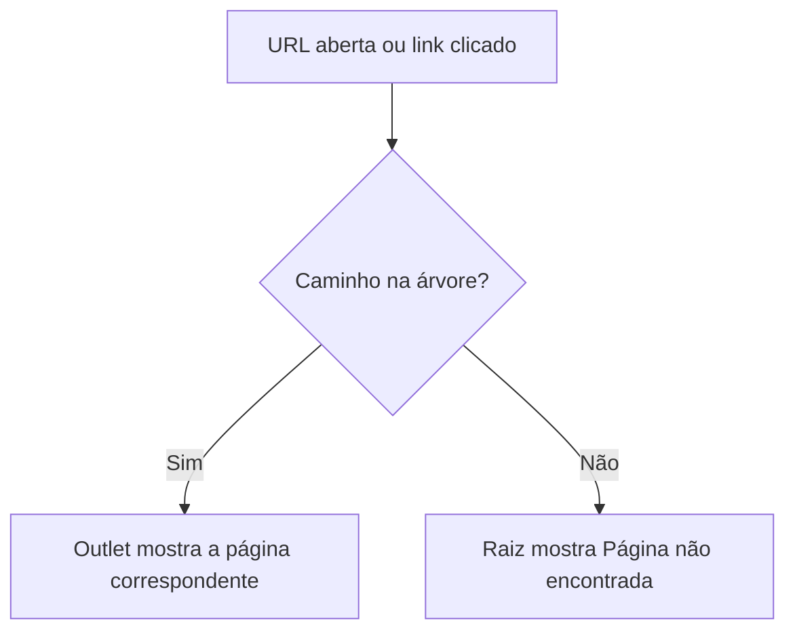

# 04. Navegação com TanStack Router

Se alguém abrir `/nfts/exemplo` diretamente, o aplicativo precisa escolher a tela de detalhe e entregar a ela o identificador `exemplo`. O TanStack Router faz essa correspondência entre a URL e a tela. Ele também permite navegar por links entre as páginas sem carregar um novo documento HTML a cada clique.

## A árvore de rotas

O KURIO usa rotas declaradas em código. `createRootRoute` define o layout comum e a tela de rota inexistente. Cada `createRoute` associa um caminho e um componente à raiz. `addChildren` monta a árvore, e a instância do roteador é criada com `createRouter`. O bloco `declare module` registra o tipo da instância para que os links sejam checados pelo TypeScript. [Configuração do Router](../../src/routes/router.tsx)

```tsx
const nftRoute = createRoute({
  getParentRoute: () => rootRoute,
  path: "/nfts/$nftId",
  component: NftPage,
});
```

O componente `Outlet` dentro de `RootLayout` é o ponto onde aparece a rota ativa. A navegação compartilhada fica fora do `Outlet`. O roteador é ligado ao React pelo `RouterProvider`. [Configuração do Router](../../src/routes/router.tsx) e [ponto de entrada](../../src/main.tsx)



## Parâmetros e navegação

O trecho `$nftId` representa uma parte variável do caminho. O link recebe o caminho declarado e passa o identificador em `params`. A própria rota tipa o resultado de `nftRoute.useParams()`. A rota de pedidos segue a mesma ideia com `$orderId`. O detalhe passa o identificador ao hook de consulta. A rota de pedidos usa o identificador para consultar o estado privado e recuperar o pedido após refresh. [Link do card](../../src/components/common/nft-card.tsx) e [rota de detalhe](../../src/routes/router.tsx)

```tsx
<Link
  to="/nfts/$nftId"
  params={{ nftId }}
  className="block rounded-control hover:text-primary"
>
  {title}
</Link>
```

```tsx
function NftPage() {
  const { nftId } = nftRoute.useParams();
  return <NftDetailPage key={nftId} nftId={nftId} />;
}
```

A prop `key={nftId}` faz o React recriar a tela ao navegar para outro NFT, reiniciando as seleções locais de imagem e edição. A consulta usa o ID em sua própria chave. Um parâmetro de caminho identifica o recurso, como `exemplo` no detalhe. Já parâmetros de busca ficam após `?` na URL e guardam os filtros do catálogo. Em um acesso direto, o servidor precisa entregar `index.html` para a URL da aplicação. O Vite fornece esse comportamento no desenvolvimento e no preview. A hospedagem pública terá de oferecer o mesmo fallback, preservando arquivos estáticos.

## Parâmetros de busca do catálogo

A rota inicial usa `validateSearch: validateCatalogSearch`. O validador recebe os valores lidos da URL e normaliza categorias, faixa ETH, disponibilidade, destaques, ordenação e página. Ele descarta valores inválidos e estabiliza a ordem das categorias, para que uma mesma seleção produza a mesma chave de consulta. [Validação do catálogo](../../src/routes/catalog-search.ts) e [rota inicial](../../src/routes/router.tsx)

```tsx
const homeRoute = createRoute({
  getParentRoute: () => rootRoute,
  path: "/",
  validateSearch: validateCatalogSearch,
  component: HomeRoute,
});
```

A rota passa `homeRoute.useSearch()` para a Home. Quando a pessoa aplica uma busca ou filtro, a página envia novos parâmetros de navegação sem a página anterior. O padrão do serviço é página 1. Ao paginar, apenas a página é alterada. As mudanças geram entradas no histórico. Formulários podem manter um rascunho até o envio. O valor aplicado vem da URL e volta a ser exibido ao navegar pelo histórico. [Home](../../src/pages/home-page.tsx) e [hook de catálogo](../../src/hooks/use-catalog.ts)

O endereço `/?q=raposa&available=true` é um exemplo direto. O TanStack Router codifica listas de categorias e strings que precisam manter seu tipo. A serialização REST é separada e envia categorias repetindo a chave. [Contrato REST](../api.md)

## Erros comuns e prática

- Montar manualmente uma string dinâmica pode esconder um erro no nome do parâmetro. Use a declaração da rota e `params` no `Link`.
- Sem `Outlet`, o layout comum pode aparecer sem o conteúdo da rota filha. Mantenha o ponto de renderização dentro do conteúdo principal.
- Uma rota inexistente e um NFT inexistente são casos diferentes. A primeira cai no tratamento global. O caminho `/nfts/inexistente` é uma rota válida. Seu ID é consultado e o HTTP 404 faz a página mostrar **NFT não encontrado**.

1. Abra a home com os mocks ativos, clique no card **Raposa Âmbar** e use o botão voltar. O caminho deve mudar para `/nfts/exemplo` e depois voltar a `/`.
2. Abra `/nfts/outro-id` em uma nova aba e recarregue. A tela deve exibir **NFT não encontrado**. Abra `/rota-inexistente` para comparar com a página de rota desconhecida.

## Perguntas de entrevista

1. **O que é uma rota raiz?** É o ponto comum da árvore. No KURIO ela contém o layout e o tratamento de caminhos desconhecidos.
2. **O que o `Outlet` renderiza?** O componente da rota filha que corresponde à URL atual.
3. **Por que usar `params` no `Link`?** O Router verifica os parâmetros que a rota exige e constrói o endereço com os valores fornecidos.
4. **Qual a diferença entre parâmetro de caminho e de busca?** O de caminho identifica uma parte da rota, como o ID do NFT. O de busca descreve opções na URL, como uma ordenação.
5. **Por que testar acesso direto além dos cliques?** O clique já ocorre com a aplicação carregada. O acesso direto exige que o servidor entregue a aplicação para aquele caminho antes que o Router possa agir.
