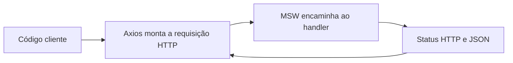

# 05. REST e Axios

Quando a home precisar dos NFTs da segunda página, ela pedirá esses dados à API. HTTP é o protocolo usado para essa conversa. Uma requisição tem um método, uma URL e, quando necessário, cabeçalhos e corpo. A resposta indica o resultado com um código de status e pode trazer dados, geralmente em JSON.

## Recursos e métodos

Uma API REST organiza operações em torno de recursos, como NFTs, carrinhos e pedidos. No KURIO, `GET /nfts` lista itens do catálogo e `GET /nfts/exemplo` consulta um item pelo ID. O método ajuda a identificar o que a operação pretende fazer.

| Método | Exemplo no KURIO                                              |
| ------ | ------------------------------------------------------------- |
| GET    | Consultar o catálogo sem pedir uma alteração.                 |
| POST   | Criar um pedido ou iniciar uma sessão.                        |
| PUT    | Aplicar um cupom ou garantir que um NFT esteja nos favoritos. |
| PATCH  | Alterar a quantidade em uma linha do carrinho.                |
| DELETE | Remover um item do carrinho.                                  |

Um `200` indica sucesso, `201` indica criação e `204` indica sucesso com corpo vazio. O status `401` sinaliza credenciais ou sessão inválida. O mock também retorna `409` para conflitos e `422` quando um campo não atende às regras. Uma conexão perdida gera erro de transporte e o Axios pode não receber status HTTP. [Contratos da API](../api.md)

## A instância Axios

O projeto usa um único cliente para reunir a URL base e o tempo máximo padrão. Assim, cada recurso pode informar apenas o caminho relativo. `paramsSerializer` repete as chaves de listas, como `category=retratos&category=paisagens`. [Cliente Axios](../../src/services/api.ts)

```ts
export const api = axios.create({
  baseURL: apiBaseUrl,
  timeout: 10_000,
  paramsSerializer: { indexes: null },
});
```

A prova de conceito já usa esse cliente para pedir um NFT. Axios transforma o JSON em um objeto e entrega esse conteúdo em `data`. O parâmetro genérico `Nft` ajuda o TypeScript a conferir o uso da resposta. A validação em execução das entradas do mock usa Zod. [Prova de conceito](../../src/mocks/browser.ts) e [tipos](../../src/types/api.ts)

```ts
const { data: before } = await api.get<NftDetail>("/nfts/exemplo");
```



## Erros comuns e prática

- Verifique se o objeto de erro contém resposta HTTP antes de ler seu status. Um timeout pode ocorrer antes de qualquer resposta.
- Mantenha preços como strings decimais. Converter para `number` pode perder precisão.
- Ao recuperar uma tentativa de pedido, mantenha corpo e chave de idempotência. Um timeout indica falta de resposta e o pedido pode já estar gravado.

1. Com os mocks ativos, consulte `/nfts` com `page: 2` seguindo o [guia de cenários](../scenarios.md). Compare `items` e `total` com a página 1.
2. Consulte `/nfts/inexistente` e depois repita em `offline`. Compare um erro com status 404 e um erro sem resposta HTTP.

## Perguntas de entrevista

1. **O que é HTTP?** É um protocolo que define como clientes enviam requisições e como servidores respondem com status, cabeçalhos e, em alguns casos, corpo.
2. **Qual a diferença entre GET e POST?** GET pede uma leitura. POST envia uma operação que pode criar um recurso ou iniciar um processo, como um pedido.
3. **Como distinguir 401 de 403?** 401 indica falta de uma autenticação válida. 403 indica que a operação solicitada está fora das permissões da conta autenticada.
4. **Por que usar uma instância Axios?** Para compartilhar URL base, timeout e outras configurações em todas as operações, usando URLs relativas nos serviços.
5. **Por que tipar a resposta e validar a entrada?** O tipo ajuda durante a escrita do programa. Dados que chegam pela rede precisam de validação em execução porque podem estar fora do contrato.
