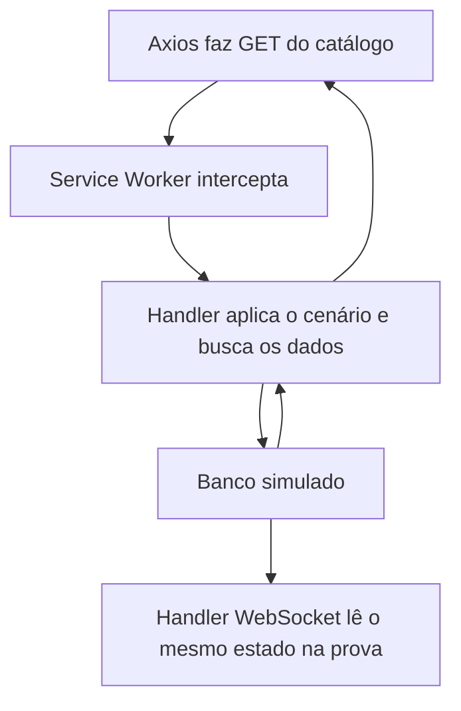

# 06. Mock Service Worker

O KURIO precisa reproduzir pedidos recusados, conexões lentas e mudanças de preço mesmo durante o desenvolvimento local. Um mock de rede produz essas respostas de forma repetível, usando os mesmos caminhos que a aplicação usaria para conversar com uma API.

## Interceptação e handlers

Interceptar uma requisição é capturá-la no caminho entre a aplicação e o destino. No navegador, o MSW usa um Service Worker para interceptar requisições HTTP. Um **handler** identifica o método e o caminho, lê os parâmetros, consulta a base simulada e monta a resposta. O MSW também intercepta WebSockets por um mecanismo próprio usado na prova Socket.IO. [Inicialização do worker](../../src/mocks/browser.ts) e [handler do catálogo](../../src/mocks/handlers/catalog.ts)

```ts
http.get(endpoint("/nfts"), ({ request }) => {
  const snapshot = currentScenario() === "empty" ? [] : readDatabase().nfts;
  return respond(request, "catalog", () =>
    HttpResponse.json(catalogPage(snapshot, new URL(request.url))),
  );
}),
```

O ponto de entrada aguarda os mocks quando `VITE_ENABLE_MOCKS=true`. Essa ordem permite interceptar as requisições que as telas fizerem assim que forem montadas. [Ponto de entrada](../../src/main.tsx)



## Persistência e reset

As **fixtures** preparam um conjunto conhecido de NFTs, usuários, carteiras e cupons. A base usa `localStorage` para manter dados depois do refresh. O ID da aba e o cenário escolhido ficam em `sessionStorage`. As transações leem o estado, aplicam uma operação e salvam o resultado. Web Locks permite ordenar escritas concorrentes na mesma origem quando o navegador oferece a API. [Fixtures](../../src/mocks/fixtures/index.ts), [banco](../../src/mocks/database.ts) e [cenários](../../src/mocks/scenarios/index.ts)

O reset restaura fixtures, relógio, contadores e IDs. Isso permite reproduzir o mesmo primeiro pedido ou a mesma sequência de atrasos. Quando o navegador restringe o armazenamento, a base pode funcionar em memória até o próximo refresh. O [guia de cenários](../scenarios.md) mostra como selecionar, executar e resetar os testes.

Em um backend real, a base e as regras de autorização ficam sob controle do servidor. No KURIO, o navegador controla o código e os dados da simulação. A autenticação serve para treinar persistência e tratamento de sessão com credenciais fictícias.

## Erros comuns e prática

- Iniciar o MSW depois de renderizar pode deixar a primeira chamada passar. Aguarde o worker antes da montagem.
- Alterar uma fixture em um teste e reaproveitar a mesma base no teste seguinte cria dependência de ordem. Reinicie o cenário e use contextos isolados.
- Colocar preços e respostas de erro dentro da tela impede testar o caminho da API. O mock deve responder ao cliente HTTP.

1. Selecione `out-of-order`. Dispare as duas páginas sem aguardar entre chamadas. A segunda deve retornar primeiro.
2. Aplique `KURIO10` ao carrinho, recarregue e consulte o carrinho. Depois, execute reset e verifique que o cupom foi removido.
3. Execute a prova Socket.IO no navegador seguindo o [guia de cenários](../scenarios.md). Compare as versões antes e depois da alteração REST.

## Perguntas de entrevista

1. **O que um handler do MSW faz?** Ele identifica uma requisição e prepara a resposta simulada, incluindo status e corpo.
2. **Por que compartilhar a base entre handlers?** Uma alteração feita no carrinho ou catálogo precisa aparecer de forma coerente nas próximas consultas e nos eventos.
3. **Qual a diferença entre fixture e cenário?** A fixture define os dados iniciais. Um cenário define a condição observada, como demora, conflito ou erro de conexão.
4. **Por que a base usa dois tipos de armazenamento?** `localStorage` mantém o estado por origem. `sessionStorage` ajuda a reter a identidade de cada aba durante seu ciclo de navegação.
5. **Por que o mock usa credenciais fictícias?** O navegador pode ler e editar a base. Esse ambiente exercita fluxos de autenticação sem oferecer as garantias de um serviço real.
