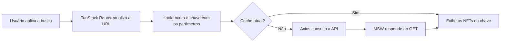
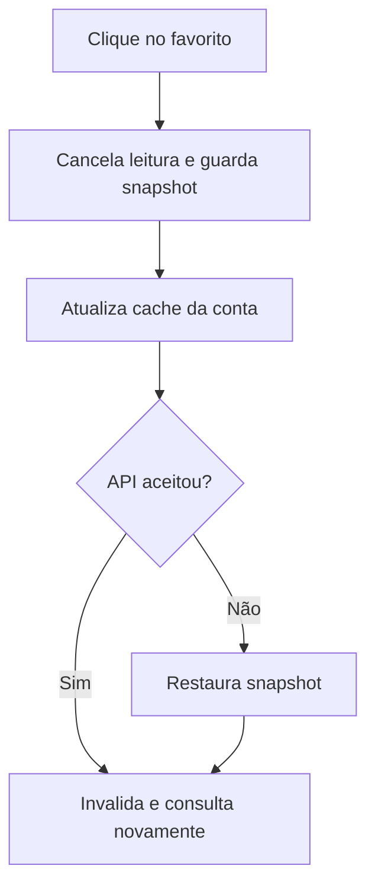

# 07. TanStack Query no catálogo

Quando um usuário abre a segunda página do catálogo, a interface precisa pedir dados, mostrar a espera, receber a resposta e decidir quando consultá-la de novo. O TanStack Query organiza esse ciclo e disponibiliza os estados da consulta à tela.

## Estado local, URL e estado remoto

- **Estado local** é informação da interação atual, como o texto digitado que ainda não foi enviado. Ele fica no [campo de busca](../../src/pages/home/search-input.tsx).
- **Estado navegável** é a seleção aplicada de busca, filtros, ordem e página. Ela fica na URL, para ser compartilhada e recuperada pelo histórico e após refresh. O [roteador](../../src/routes/router.tsx) valida e entrega esses parâmetros à Home.
- **Estado remoto** é o conteúdo retornado pela API, como NFTs, quantidade de resultados e total de páginas. A Query mantém esses dados no cache. [Página inicial](../../src/pages/home-page.tsx)



## Consultas e chaves

Uma **query** é uma consulta de leitura. A **query key** identifica o resultado no cache, uma memória temporária da biblioteca. Dois conjuntos diferentes de filtros são duas consultas. Já duas partes da tela com a mesma chave podem compartilhar o resultado.

O hook preenche os padrões de página, tamanho e ordenação antes de criar a chave. O trecho abaixo vem das opções do catálogo. [Hook de catálogo](../../src/hooks/use-catalog.ts)

```ts
queryKey: ["nfts", "catalog", queryParams],
queryFn: ({ signal }) => fetchCatalog(queryParams, signal),
...nftQueryPolicy,
```

O serviço envia os parâmetros e o sinal ao Axios. A Home chama o mesmo hook para os destaques, com parâmetros próprios. [Serviço de catálogo](../../src/services/catalog.ts) e [Home](../../src/pages/home-page.tsx)

```ts
const { data } = await api.get<CatalogPage>("/nfts", { params, signal });
```

## Atualização, cancelamento e erros

**Stale time** é o período em que a biblioteca considera a resposta atual. O catálogo usa 30 segundos. Depois disso, a consulta fica marcada como desatualizada. Ela pode ser reexecutada, por exemplo, ao voltar à aba, reconectar ou montar a tela novamente. Isso é um **refetch**. Se já houver dados para a mesma chave, a Home mantém os cards e informa que está atualizando. A primeira consulta sem dados exibe um skeleton.

**Garbage collection** é a remoção de dados que ficaram sem observadores. O catálogo guarda essas entradas no cache por até cinco minutos após o último observador sair. Recarregar a página preserva a URL, mas recria o cache em memória e faz nova consulta.

Quando uma consulta deixa de ser observada, a Query pode cancelar seu `AbortSignal`. Ao repassar o sinal para o Axios, o catálogo evita esperar uma busca antiga que perdeu relevância. A resposta também pertence à chave da consulta que a pediu, o que mantém resultados diferentes separados.

A política permite uma repetição automática para falhas transitórias, como 500, 408, 429 ou erro de rede e timeout reconhecidos. Cancelamento e erros como 400 ou 422 seguem diretamente para o tratamento. O botão **Tentar novamente** faz um refetch manual. [Política de consultas de NFT](../../src/lib/nft-query-policy.ts)

## A consulta de detalhe

A chave do detalhe inclui o ID recebido do roteador. Assim, abrir um item relacionado inicia ou reaproveita a consulta daquele NFT. O detalhe compartilha a política de leitura com a listagem e encaminha o sinal de cancelamento ao Axios. A galeria e a edição selecionada são escolhas locais, então alterá-las não abre novas consultas. [Hook de detalhe](../../src/hooks/use-nft.ts), [serviço](../../src/services/nfts.ts) e [página](../../src/pages/nft-detail-page.tsx)

```ts
queryKey: ["nfts", "detail", nftId],
queryFn: ({ signal }) => fetchNft(nftId, signal),
...nftQueryPolicy,
```

A página diferencia três casos. Sem dados durante a consulta, renderiza um skeleton. Se a API retorna 404, mostra que o NFT não existe, sem retry automático. Para falha transitória, oferece nova tentativa. Os itens relacionados usam uma consulta de catálogo por categoria, com estado de erro próprio.

## Mutations e atualização otimista de favoritos

Uma **query** lê dados, como `GET /favorites`. Uma **mutation** solicita uma alteração, como PUT ou DELETE de um favorito. O catálogo, o detalhe e a página privada leem a mesma chave de favoritos da conta.

A atualização otimista mostra o resultado esperado antes da resposta da API. Primeiro, `onMutate` cancela consultas àquela chave, para evitar que uma resposta em andamento apague a alteração local. Em seguida, guarda o **snapshot** do valor anterior e escreve a lista atualizada. As ações de favorito ficam bloqueadas durante uma gravação para evitar snapshots concorrentes. [Hook de favoritos](../../src/hooks/use-favorites.ts)

```ts
await client.cancelQueries({ queryKey, exact: true });
scope.lifetime.throwIfAborted();
const previous = client.getQueryData<Favorites>(queryKey);
if (previous) {
  const nftIds = previous.nftIds.filter((id) => id !== nftId);
  if (favorite) nftIds.push(nftId);
  client.setQueryData<Favorites>(queryKey, { nftIds });
}
return { previous };
```

**Rollback** é restaurar o snapshot quando a gravação falha. **Invalidar** é marcar a consulta como desatualizada para buscar novamente o valor da API. Em favoritos, a invalidação acontece tanto no sucesso como na falha. Se a sessão mudou nesse intervalo, o sinal abortado impede que o rollback e a invalidação tragam de volta a entrada privada removida.



Para testar, use o [cenário favorite-error](../scenarios.md#falha-de-favoritos) e tente incluir e remover. Observe a mudança imediata e a restauração. Repita no cenário padrão, recarregue e troque de conta para conferir a persistência isolada.

## Erros comuns e prática

- Chave sem os filtros faz buscas diferentes compartilharem uma entrada de cache. Inclua todos os parâmetros usados no serviço.
- Usar o resultado da última chave como se pertencesse à nova busca confunde o usuário. A Home utiliza skeleton na primeira consulta de cada chave sem dados.
- Uma seleção de teste pode alterar a base durante a validade do cache. Após selecionar um cenário no console, recarregue a página para iniciar com cache vazio.

1. Acesse a segunda página, envie uma nova busca e use Voltar no navegador. A nova busca deve começar na página 1 e o histórico deve retornar à página 2.
2. Ative `out-of-order` pelo [guia de cenários](../scenarios.md), recarregue e envie duas buscas em sequência. Observe as requisições na aba Rede. A busca mais recente deve controlar os resultados visíveis.
3. Selecione `offline` e recarregue para ver o estado de erro. Volte ao cenário padrão pelo console e clique em **Tentar novamente**.

## Perguntas de entrevista

1. **Por que colocar filtros na query key?** A chave precisa separar resultados que podem ser diferentes. No KURIO, página 1 e página 2 possuem entradas próprias.
2. **Qual é a diferença entre stale time e garbage collection?** Stale time define a validade do dado para decisões de refetch. Garbage collection define por quanto tempo uma entrada sem observadores fica guardada.
3. **Quando um refetch pode manter os cards visíveis?** Quando a consulta já tem dados da mesma chave. A Home sinaliza atualização enquanto espera a nova resposta.
4. **Por que repassar o AbortSignal para Axios?** Assim, o cancelamento alcança a operação HTTP, reduzindo trabalho para uma consulta que perdeu relevância.
5. **Por que evitar retry automático para 422?** A entrada precisa ser corrigida. Repetir os mesmos parâmetros normalmente reproduz o erro.
