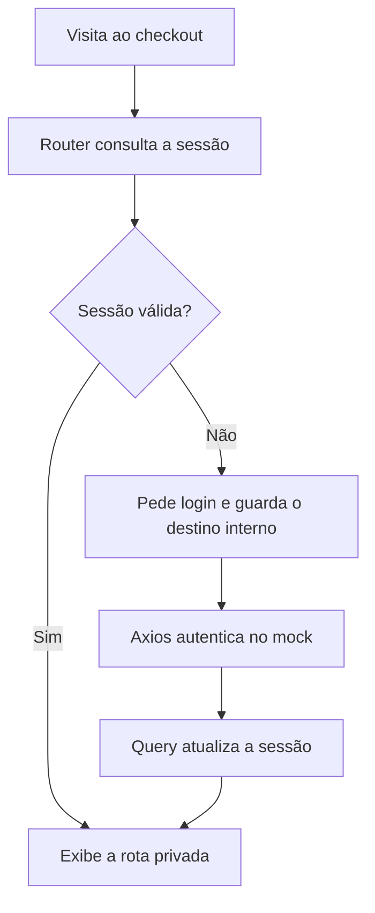

# 08. Autenticação e sessão

O checkout precisa saber quem está comprando. **Autenticação** identifica a conta, como no login com e-mail e senha. **Autorização** decide o que essa conta pode acessar. Por exemplo, o mock só retorna um pedido para a pessoa que o criou.

## Como a sessão funciona

Login e cadastro retornam uma sessão, que representa a identidade autenticada por um período. No KURIO, o mock guarda a associação entre visitante e usuário. Após refresh, a aplicação consulta `GET /auth/session` e preenche o cache novamente. O identificador do visitante enquanto navega na mesma aba permite recuperar essa associação.

A sessão dura uma hora no relógio do mock. A resposta também traz o tempo restante em milissegundos. A aplicação usa essa duração para acompanhar o vencimento mesmo quando o relógio do cenário é diferente do relógio do navegador. A consulta é repetida ao navegar para uma rota privada, na reconexão, ao focar a janela e periodicamente enquanto houver sessão. Falha de conexão gera um erro com nova tentativa. Uma resposta 401 de sessão indica que é preciso entrar novamente. [Serviço de autenticação](../../src/services/auth.ts), [cache de sessão](../../src/lib/session.ts) e [API](../api.md)

## Rotas públicas e privadas

Catálogo, carrinho, login e cadastro são públicos. Checkout, perfil, carteiras, favoritos e pedidos ficam sob uma rota pai privada, sem mudar o caminho das páginas. O `beforeLoad` roda antes de renderizar os filhos. Se não houver sessão, redireciona para login com o caminho original validado. [Configuração de rotas](../../src/routes/router.tsx) e [validação do retorno](../../src/routes/auth-search.ts)

```ts
const previous = queryClient.getQueryData<Session | null>(sessionKey);
const session = await queryClient.fetchQuery(sessionQuery);
```

O parâmetro `returnTo` aceita caminhos internos conhecidos e preserva consulta e fragmento. Destinos externos, rotas de autenticação e caminhos desconhecidos são descartados. Após login ou cadastro, o visitante pode retomar o destino. A URL pode carregar uma etapa de checkout. Os dados de compra e seu vínculo com a conta serão integrados nas etapas correspondentes.



## Isolamento ao sair ou trocar de conta

A sessão tem uma única chave no cache. As consultas privadas devem usar o prefixo `private` e incluir o ID do usuário. Em uma troca de identidade, a aplicação cancela e remove essas consultas e aborta o sinal da sessão anterior. O conector de tempo real poderá usar esse sinal para liberar listeners e impedir entregas tardias. Catálogo e outras consultas públicas permanecem disponíveis. [Ciclo de sessão](../../src/lib/session.ts)

```ts
void queryClient.cancelQueries({ queryKey: privateKey });
queryClient.removeQueries({ queryKey: privateKey });
```

Logout chama a API e só então limpa a sessão. A aplicação também descarta a identidade quando recebe um 401 de sessão correspondente à identidade corrente. O mock incorpora o carrinho visitante ao da conta quando a autenticação é bem-sucedida. A interface consulta o carrinho com o novo escopo e apresenta conflitos de mesclagem.

A simulação usa apenas credenciais fictícias e guarda verificadores de senha com salt na base local. O navegador pode ler ou alterar essa base, por isso o mock serve para estudar fluxo, tratamento de erro e isolamento da interface. Ele não oferece as garantias de uma autenticação de produção. [Cenários e credenciais fictícias](../scenarios.md)

## Dados do colecionador

Perfil, carteiras e favoritos usam chaves formadas pelo prefixo privado, ID do usuário e recurso. O [cliente de conta](../../src/services/account.ts) combina o sinal da consulta com o sinal da sessão. Ele também informa o ID esperado. O [handler da sessão](../../src/mocks/handlers/shared.ts) compara o ID com a conta ativa e rejeita a tentativa se a identidade tiver mudado. Isso evita que uma operação iniciada por Ana altere os dados de Bruno quando a resposta estiver atrasada.

O [ciclo de sessão](../../src/lib/session.ts) cancela consultas, remove queries e mutations privadas e encerra o sinal anterior. As páginas privadas também são recriadas com a chave do usuário, de modo que campos de formulários e prévias locais sejam descartados na troca. Favoritos e carteiras confirmados permanecem na base simulada da conta original.

## Erros comuns e exercícios

- Confundir offline com logout apaga a identidade por causa de um problema de conexão. O código limpa a sessão por resposta de autenticação ou logout confirmado.
- Redirecionar para o texto recebido na URL permite enviar usuários a outros domínios. Valide o destino antes da navegação.
- Esquecer de cancelar consultas privadas permite que uma resposta antiga chegue após mudar de conta.

1. Abra `/checkout?step=review#taxas` sem sessão. Entre com uma conta fictícia e confira se o destino foi recuperado. Recarregue e confirme que a sessão continua.
2. Com uma conta autenticada, avance o relógio em uma hora com `await window.kurioMocks.advanceClock(3_600_000)` e acesse uma área privada. Entre novamente quando solicitado. Depois, saia e acesse com o segundo usuário.

## Perguntas de entrevista

1. **Qual a diferença entre autenticação e autorização?** Autenticação identifica a conta. Autorização verifica se ela pode acessar um recurso específico.
2. **Por que consultar a sessão após refresh?** A memória do JavaScript é recriada. Só uma consulta à fonte que mantém a sessão confirma se ela continua válida.
3. **Onde o KURIO protege uma rota?** O Router verifica a sessão antes de montar a rota privada. A API simulada também valida acesso aos dados privados.
4. **Por que remover queries no logout?** Impede que dados privados anteriores sejam reaproveitados por uma nova sessão. Cancelar consultas complementa essa remoção ao encerrar operações em andamento.
5. **Por que o mock não serve como autenticação de produção?** O ambiente do cliente controla o código e a base. Um servidor confiável precisa impor identidade, validade da sessão e autorização.
