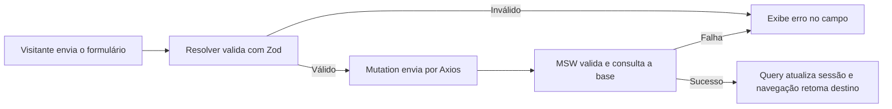

# 09. Formulários e validação

Se o visitante digitar um e-mail incompleto ao criar uma conta, a tela pode indicar o problema antes de enviar a requisição. Se o formato estiver correto, a API ainda precisa decidir se o e-mail está disponível.

## React Hook Form e Zod

React Hook Form registra os campos, guarda o estado do formulário e controla o envio. No KURIO, `register(name)` liga cada input ao formulário. `handleSubmit` valida os campos e só chama a função de envio se a entrada passar pelas regras.

Zod define quais valores são aceitos. O mesmo componente usa o esquema de credenciais no login e acrescenta a regra de nome obrigatório no cadastro. O `zodResolver` conecta os esquemas ao React Hook Form. [Formulário compartilhado](../../src/components/auth/auth-form.tsx)

```tsx
useForm({
  resolver: zodResolver(isRegistration ? registration : credentials),
  defaultValues: { name: "", email: "", password: "" },
});
```

A página dedicada e o diálogo reutilizam o formulário, passando o modo e a função que executa após autenticar. O diálogo gerencia o foco e o fechamento. O formulário gerencia campos, validação e envio. [Página de autenticação](../../src/pages/auth/auth-page.tsx) e [diálogo](../../src/components/auth/auth-dialog.tsx)



## Erros locais e erros da API

A validação na tela ajuda a corrigir o preenchimento cedo. O servidor recebe requisições de qualquer cliente e precisa validar novamente. No mock, o handler também aplica Zod ao corpo e verifica conflitos na base. Um e-mail existente retorna 409 com `fields.email`. Credenciais incorretas retornam 401 com mensagem geral. [Handlers de conta](../../src/mocks/handlers/account.ts) e [contratos de erro](../api.md)

A tela usa `setError` para associar a mensagem ao campo e focar o primeiro erro enviado pela API. O campo recebe `aria-invalid` e referencia a mensagem por `aria-describedby`. Problemas gerais aparecem em uma mensagem anunciada pela tecnologia assistiva. [Formulário compartilhado](../../src/components/auth/auth-form.tsx)

Durante a requisição, o botão de envio fica desativado. Credenciais permanecem temporariamente em memória durante o preenchimento e o envio. Após o sucesso, a senha é limpa do formulário, e a mutation é retirada do observador ao finalizar. A base simulada guarda o verificador com salt.

## Avatar e formulários privados

O formulário de perfil recebe os dados confirmados da API como valores iniciais. Ao escolher o avatar, `readAvatar` verifica o tipo e limita o arquivo a 512 KiB antes de usar `FileReader.readAsDataURL`. O esquema confere o tamanho codificado e a assinatura binária, e o navegador tenta decodificar a imagem. O formulário usa essa data URL para a prévia. A API valida novamente e só grava quando o perfil é salvo. Remover o avatar envia `null`. [Leitura do avatar](../../src/lib/avatar.ts), [formulário de perfil](../../src/pages/account/profile-page.tsx) e [validação na API](../../src/mocks/handlers/account.ts)

```tsx
setValue("avatarUrl", await readAvatar(file), { shouldDirty: true });
clearErrors("avatarUrl");
```

A confirmação da nova senha é validada no formulário. O envio tem apenas senha atual e nova senha, e o mock verifica se a senha atual corresponde ao verificador persistido. O formulário de carteira limita rede e tipo às opções simuladas e valida o endereço hexadecimal. Ele oferece os mesmos campos para os dois espaços. [Esquemas](../../src/lib/account-schema.ts) e [formulário de carteiras](../../src/pages/account/wallets-page.tsx)

## Erros comuns e exercícios

- Confundir formato válido com cadastro permitido. Só a API consulta se o e-mail já existe.
- Exibir o erro sem associá-lo ao campo. Use o ID da mensagem em `aria-describedby`.
- Exibir uma mensagem de credenciais inválidas para falha de rede. Os casos têm causas e formas de recuperação diferentes.

1. Envie o cadastro com nome vazio e e-mail inválido. Confira as mensagens e o foco. Corrija o formato e use o e-mail fictício de Ana. Agora a mensagem do campo deve vir da API.
2. Abra o modal de login no desktop, verifique o foco inicial e pressione Escape. O foco deve voltar ao acionador. Em uma aba nova, abra `/login` e confira a página dedicada.

## Perguntas de entrevista

1. **O que o React Hook Form resolve?** Ele organiza campos, eventos, estados de erro e envio, evitando repetir essa lógica para cada input.
2. **Qual o papel do Zod?** Aplicar regras em tempo de execução, como verificar o formato do e-mail, e produzir mensagens que o formulário pode exibir.
3. **Por que validar no frontend e na API?** A validação local melhora a resposta imediata. A API protege as regras para todos os clientes e verifica informações que só ela conhece.
4. **Quando usar `setError`?** Ao receber uma falha que deve aparecer no formulário, como um e-mail já usado que só a API consegue verificar.
5. **Por que desativar o botão durante o envio?** Para comunicar que a solicitação está em andamento e evitar envios repetidos causados por múltiplos cliques.
