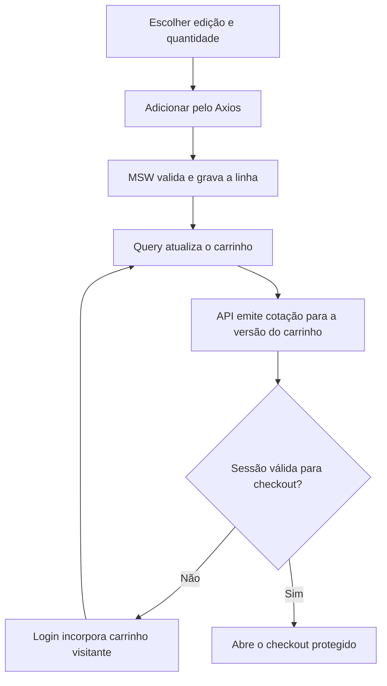

# 10. Carrinho e cotação

Um NFT pode ter mais de uma edição. Se uma pessoa adicionar a edição Padrão e depois a Limitada, o KURIO precisa manter duas linhas. Se adicionar a Padrão novamente, a nova quantidade entra na linha existente, desde que o estoque comporte a soma.

## Estado, identidade e persistência

O carrinho é estado remoto. A interface chama o Axios para ler ou alterar um carrinho. O MSW grava as mudanças na base simulada, e o TanStack Query mantém a cópia usada para renderizar a tela. O [serviço](../../src/services/cart.ts) envia operações de adição, quantidade, remoção e cupom. O [hook](../../src/hooks/use-cart.ts) usa a resposta da mutation para atualizar o cache.

Cada linha é identificada por NFT e edição. A [base simulada](../../src/mocks/cart.ts) cria essa identidade assim:

```ts
export function itemId({ nftId, editionId }: CartItemInput) {
  return `${nftId}~${editionId}`;
}
```

A API valida quantidades inteiras e disponibilidade em cada mudança, pois o estoque pode ter mudado desde a última leitura. A [página de carrinho](../../src/pages/cart/cart-page.tsx) mostra a lista e oferece ajuste para o máximo disponível quando uma edição fica com estoque menor. Quando o estoque zera, a linha pode ser removida.

Por trás do MSW, a base usa `localStorage`. A identidade do visitante vem de `sessionStorage` e continua na mesma aba após refresh. Para uma pessoa autenticada, a API recupera o carrinho pelo ID da conta. A troca de identidade descarta a cópia anterior no cache e cancela operações em andamento.

## Mesclagem ao entrar

Ao autenticar, o mock soma as quantidades da mesma edição dos dois carrinhos. Em cada linha que recebeu itens do visitante, mantém até o estoque atual. Por exemplo, 5 unidades na conta mais 4 do visitante com estoque de 6 resultam em 6, com aviso de que 3 ficaram de fora. O cupom da conta tem prioridade. Sem cupom na conta, o mock usa o do visitante. A entrada visitante é consumida uma vez, evitando reaplicar a mesclagem em outro login. [Regra de mesclagem](../../src/mocks/cart.ts)



## Valores em ETH

O tipo `number` em JavaScript usa ponto flutuante binário. Alguns decimais não têm representação exata nesse formato. Por exemplo, `0.1 + 0.2` pode produzir `0.30000000000000004`. Arredondar só na exibição pode esconder a diferença sem corrigir o valor gravado.

Os contratos do KURIO usam strings decimais. A API cria valores com Decimal.js, multiplica preço pela quantidade inteira e soma sem converter ETH para `number`. O trecho abaixo é parte do [cálculo de cotação](../../src/mocks/cart.ts).

```ts
const subtotal = items.reduce(
  (total, item) => total.plus(new Money(item.price).times(item.quantity)),
  new Money(0),
);
const discount = subtotal
  .times(percent)
  .div(100)
  .toDecimalPlaces(18, Decimal.ROUND_HALF_UP);
```

A API retorna subtotal, desconto, taxa de rede e total como strings. O [PriceDisplay](../../src/components/common/price-display.tsx) muda apenas o separador decimal na apresentação. O [OrderSummary](../../src/pages/cart/order-summary.tsx) exibe os valores já calculados.

## Cotação e revisão

O preço exibido no catálogo informa quanto custa uma edição naquele momento. Para seguir para o checkout, a cotação valida novamente o estoque e o cupom, registra os valores atuais e tem validade de cinco minutos. Ela traz um ID próprio e a versão do carrinho que foi cotada. A versão muda quando itens, quantidades, preço, estoque ou cupom mudam. Ao receber uma nova versão, a interface busca outra cotação e bloqueia o avanço até ela estar disponível. O backend revalida a cotação na criação do pedido. [Handlers de comércio](../../src/mocks/handlers/commerce.ts) e [contratos REST](../api.md)

## Pagamento e recuperação

O checkout conecta uma carteira fictícia pela API simulada. O estado da conexão fica na tela. Trocar carteira ou rede e desconectar exigem nova revisão. O cenário `wallet-declined` demonstra uma recusa de conexão.

Quando o envio começa, o checkout salva a chave de idempotência e o corpo da tentativa no `sessionStorage` da aba por usuário. Se a resposta falhar, o botão de retomada reaproveita a chave e o corpo. O handler recupera o pedido registrado. [Checkout](../../src/pages/checkout/checkout-page.tsx) · [Tentativa](../../src/pages/checkout/order-attempt.ts) · [Cenários](../scenarios.md)

## Erros comuns e exercícios

- Usar só o ID do NFT como identidade mistura edições distintas.
- Somar ETH com `number` pode introduzir diferenças entre o valor mostrado e o valor enviado.
- Reaproveitar uma cotação quando o estoque mudou permite revisar valores antigos. Compare a versão e busque outra cotação.

1. Adicione duas edições do mesmo NFT disponíveis no catálogo. Alterar a quantidade de uma deve preservar a outra.
2. Use `KURIO10` e compare subtotal, desconto e total. Depois, tente `VENCIDO` e verifique a mensagem.
3. Siga o [cenário de alteração de preço ou estoque](../scenarios.md#preço-e-estoque-com-o-carrinho-aberto). Atualize a cotação e confira a mudança de versão.

## Perguntas de entrevista

1. **Por que a chave do item inclui a edição?** Porque uma edição tem seu próprio preço e estoque. As duas linhas precisam ser atualizadas de forma independente.
2. **Onde fica o carrinho após refresh?** Na base do mock gravada em `localStorage`. A aplicação consulta novamente usando a identidade do visitante ou da conta.
3. **Por que usar decimal a partir de uma string?** Assim, o Decimal.js começa com o valor descrito no contrato, sem receber antes a aproximação de um ponto flutuante.
4. **Qual é o papel da cotação?** Reunir preços, estoque, taxas e cupom verificados para uma revisão específica. Ela vincula os valores a uma versão e tem vencimento.
5. **Por que validar estoque na interface e na API?** A interface orienta a escolha no momento. A API confirma a disponibilidade atual, inclusive se ela mudou durante a navegação.
