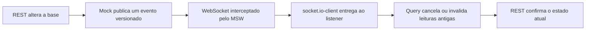
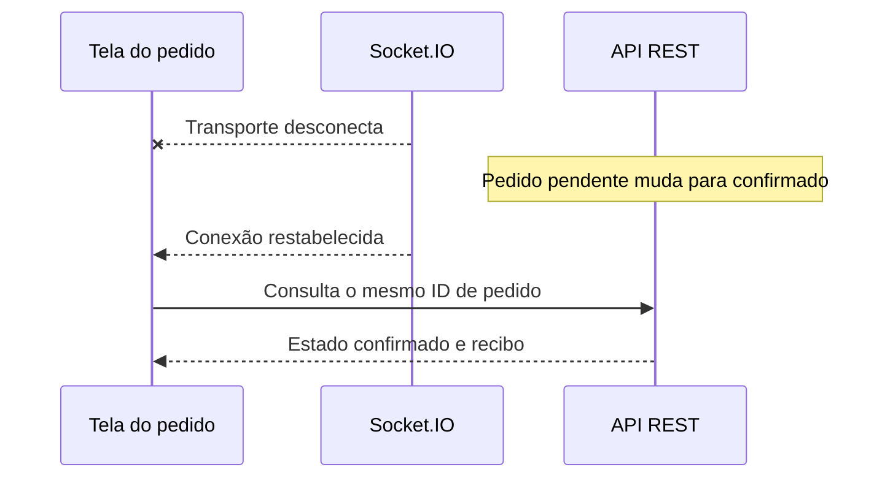

# 11. Tempo real com Socket.IO

Imagine revisar um pedido enquanto o preço de um NFT muda. Com HTTP, a página descobre isso quando faz outra consulta. Com comunicação em tempo real, uma conexão já aberta pode entregar o aviso assim que a mudança ocorre.

## WebSocket, Socket.IO e eventos

WebSocket cria um canal no qual cliente e servidor podem enviar mensagens enquanto a conexão estiver aberta. Socket.IO usa um protocolo próprio acima do transporte. No KURIO, fornece eventos nomeados e tentativas de reconexão. Um **listener** é a função registrada para receber um evento, como `nft.updated`.

O MSW intercepta o WebSocket da aplicação. O handler responde à abertura do Engine.IO, aceita a conexão do namespace Socket.IO e responde aos pings esperados pelo protocolo. Ao receber uma mudança persistida, envia frames de evento para o cliente real. [Conexão](../../src/services/socket.ts) e [handler do mock](../../src/mocks/handlers/socket.ts)



## Versões e reconciliação

A versão aumenta quando o recurso muda. Uma duplicata carrega a mesma versão e o mesmo ID de evento. Um evento fora de ordem pode chegar com versão menor. O cliente guarda a maior versão já vista antes de aceitar uma alteração, como mostra o trecho do [controle de versões](../../src/lib/live-versions.ts).

```ts
if (!Number.isSafeInteger(version) || version <= (nftVersions.get(id) ?? 0))
  return false;
nftVersions.set(id, version);
```

A mesma ideia vale para HTTP. Uma requisição lenta pode ter lido a versão anterior antes de a mudança ocorrer. O KURIO cancela essas leituras e rejeita snapshots mais antigos. O carrinho também usa a versão como parte da chave da cotação, de modo que novos valores exijam confirmação no checkout.

Quando o socket cai, alguns eventos podem se perder. Ao conectar novamente, o client dispara a reconciliação de consultas ativas pela API. O status de pedido vem do REST, mesmo quando um evento avisa que houve confirmação ou recusa. Isso mantém a tela e o recibo coerentes após refresh ou reconexão. [Reconciliação](../../src/lib/reconcile-realtime.ts) e [consulta do pedido](../../src/hooks/use-order.ts)



## Ciclo de vida e escala do mock

O layout registra listeners quando a sessão é conhecida. Ao trocar de conta ou desmontar a conexão, remove cada listener e chama `disconnect()`. Pedidos também carregam o ID da sessão e só chegam aos clientes autorizados. Um evento público do catálogo pode ser recebido pelo visitante. [Ciclo de vida](../../src/components/layout/realtime-connection.tsx)

O mock usa um recorte do protocolo compatível com WebSocket e mensagens de texto. Os controles de atraso, replay e interrupção atuam antes de o frame chegar ao cliente Socket.IO. [Contratos e cenários](../events.md)

## Erros comuns e exercícios

- Registrar listeners a cada renderização pode duplicar alertas. Registre uma vez por conexão e remova no encerramento.
- Mostrar recibo apenas porque chegou um evento torna difícil recuperar a compra após refresh. Consulte o pedido e exiba o resultado retornado pela API.
- Reconectar sem refazer as consultas pode manter o preço anterior. Busque os recursos ativos ao voltar.

1. Aprove uma cotação no checkout e altere o preço seguindo o [roteiro](../events.md#reproduzir-no-navegador). O envio deve ficar indisponível até confirmar os novos valores.
2. Envie um pedido e desconecte o transporte. Avance o relógio, reconecte e verifique o mesmo ID com o estado atualizado.
3. Repita um evento de preço com tipo `older` e observe que a versão e o preço não voltam ao valor anterior.

## Perguntas de entrevista

1. **Quando HTTP ainda é útil com Socket.IO?** Para obter o estado completo de um recurso e recuperar mudanças que se perderam durante uma desconexão.
2. **Qual é a diferença entre WebSocket e Socket.IO?** WebSocket é o transporte bidirecional. Socket.IO acrescenta um protocolo de eventos e gerencia aspectos como conexão e reconexão.
3. **Como distinguir evento novo de duplicata?** Compare a versão recebida com a maior versão conhecida do recurso. A mesma versão já foi observada.
4. **Por que cancelar uma consulta quando chega um evento?** Uma requisição ainda em andamento pode entregar o estado que existia antes da mudança.
5. **Por que o logout remove listeners?** Para encerrar o ciclo da sessão e impedir que mensagens da conta anterior afetem a próxima.
