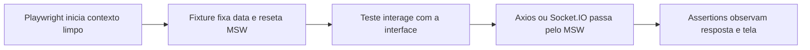

# 12. Testes automatizados com Playwright

Quando o preço muda durante o checkout, o KURIO precisa atualizar a cotação e bloquear o envio até uma nova revisão. Um teste automatizado repete essa situação e verifica o resultado com as mesmas condições a cada execução.

## Tipos de teste

| Tipo       | O que verifica                         | Exemplo                                                                   |
| ---------- | -------------------------------------- | ------------------------------------------------------------------------- |
| Unitário   | Um comportamento pequeno em isolamento | Validar os limites de uma função que ajusta quantidade ao estoque.        |
| Integração | A comunicação entre algumas partes     | Enviar uma requisição Axios e conferir a resposta de um handler MSW.      |
| E2E        | O fluxo completo pela interface        | Abrir o catálogo, adicionar um NFT, entrar, revisar e consultar o recibo. |

O Playwright dirige um navegador real. Os [testes E2E](../../tests/e2e) usam o build demo, com React, roteamento, Axios, Service Worker e cliente Socket.IO. O teste pode usar um endpoint de controle do mock para mudar a situação, mas as telas continuam passando pelos caminhos normais de rede. [Configuração](../../playwright.config.ts)

## Locators e assertions

Um locator descreve como localizar um elemento. `getByRole` busca pelo papel e pelo nome acessível. Assim, o mesmo teste pode encontrar um botão em desktop e mobile sem depender das classes de estilo. As assertions, como `toBeVisible`, aguardam o estado esperado dentro do tempo limite. [Testes de tempo real](../../tests/e2e/realtime.spec.ts)

```ts
await expect(
  page.getByRole("button", { name: "Enviar pedido" }),
).toBeDisabled();
```

Também é possível verificar a resposta de uma operação. Registre a espera **antes** do clique para evitar perder a resposta, que pode chegar rapidamente. [Testes de comércio](../../tests/e2e/commerce.spec.ts)

```ts
const applied = responseFor(page, "PUT", "/cart/coupon");
await page.getByRole("button", { name: "Aplicar", exact: true }).click();
expect((await applied).status()).toBe(200);
await expect(page.getByText("0,136 ETH", { exact: true })).toBeVisible();
```

## Fixtures, isolamento e determinismo

Uma fixture prepara recursos que o teste usa. O Playwright cria um contexto de navegador por teste, separando armazenamento e sessões. A [fixture do KURIO](../../tests/e2e/fixtures.ts) fixa a data do navegador, inicia a aplicação, seleciona o cenário e reseta a base do mock. O teste pode adiantar o relógio simulado para obter a resposta do pedido sem esperar seu prazo real. A latência continua sendo simulada pelos cenários do MSW.

Os cenários de preço e estoque alteram a base via REST de controle. O mock publica o evento por WebSocket. O teste verifica a conexão, as respostas das consultas e o saldo ou o status visível. Retomar um pedido após timeout compara a chave, o corpo e o ID devolvido pela API.



## Regressão visual, relatórios e traces

A [suíte visual](../../tests/visual/screens.spec.ts) captura Home, detalhe, carrinho e checkout após a interface carregar e as imagens decodificarem. Uma _baseline_ é uma captura aprovada usada como referência. Gere capturas com a mesma versão de Chromium, fontes e ambiente. Confira cada diferença antes de versionar a atualização. Os comandos estão no [README](../../README.md).

O relatório HTML mostra o resultado de cada teste. Um _trace_ guarda passos, snapshots e atividade de rede para investigar falhas. A configuração retém traces e screenshots quando um teste falha. Uma falha na inicialização do servidor pode acontecer antes de abrir qualquer página, por isso ela pode não ter trace de interação.

## Como criar um teste

1. Use `test` e `expect` da [fixture](../../tests/e2e/fixtures.ts).
2. Comece com `await mocks.start()`, escolhendo o cenário se ele for necessário.
3. Interaja com a interface por papel, label ou nome acessível. Registre a espera de rede antes de uma ação quando for verificar o status.
4. Confira a consequência visível e, onde fizer sentido, o estado retornado pela API.
5. Rode o arquivo nos dois projetos Chromium e abra o relatório se houver falha.

## Exercícios

- Amplie o teste de estoque para verificar uma quantidade disponível menor que a solicitada. A cotação deve pedir ajuste.
- Compare o HTML e o trace de um cenário real de falha de rede. Localize a resposta ausente e o aviso que aparece na interface.

## Perguntas de entrevista

1. **Por que testar E2E se já existem testes de integração?** O E2E verifica se o aplicativo funciona do ponto de vista do usuário, incluindo seleção, navegação e feedback.
2. **Por que evitar `waitForTimeout`?** Uma espera fixa pode ser curta em uma execução lenta ou desperdiçar tempo em uma rápida. Assertions aguardam a condição exata.
3. **O que torna um cenário determinístico?** O teste controla dados iniciais, relógio e ações. A mesma entrada produz a mesma sequência esperada.
4. **Quando atualizar uma baseline?** Após verificar que a diferença visual foi intencional e que a captura representa o estado correto.
5. **Qual a diferença entre relatório e trace?** O relatório organiza resultados. O trace permite investigar detalhes de uma execução, passo a passo.
