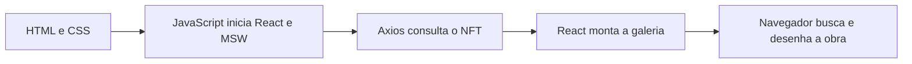

# Performance frontend

Ao abrir o detalhe de um NFT, o navegador precisa baixar o HTML, interpretar CSS, executar JavaScript, consultar os dados e desenhar a obra. Performance frontend mede quanto trabalho existe nesse caminho e o que o visitante percebe enquanto espera.



## Bundle, imagens e fontes

O bundle é o JavaScript que o Vite prepara para o navegador. Ele pode ter vários arquivos menores, chamados chunks. Uma importação dinâmica permite buscar um chunk quando ele for necessário. No KURIO, o ponto de entrada carrega o módulo dos mocks com `await import("@/mocks/browser")` quando a demonstração está habilitada. Separar páginas pouco visitadas pode reduzir o JavaScript inicial, mas também acrescenta uma requisição ao entrar nelas. O tamanho dos arquivos e o tempo de execução ajudam a decidir. [Ponto de entrada](../../src/main.tsx)

Lazy loading adia o carregamento de uma imagem até ela se aproximar da área visível. A imagem principal da galeria mantém `fetchPriority="high"`. A marcação deixa as miniaturas com prioridade normal e permite carregá-las mais tarde. O trecho abaixo é da miniatura da galeria. Os atributos de tamanho registram o tamanho intrínseco, e o CSS controla o tamanho exibido. [Galeria](../../src/pages/nft-detail/nft-gallery.tsx)

```tsx

```

O tema usa fontes do sistema, o que evita uma requisição adicional. A etapa também alinhou as dimensões do hero, cards e promoções às artes locais e adicionou uma descrição ao HTML. O efeito desses ajustes na experiência e nas notas ainda precisa de medição. [Tema](../../src/styles/globals.css) · [HTML](../../index.html)

## Lighthouse e leitura dos resultados

Lighthouse abre a página no Chrome, observa a navegação e gera notas de performance, acessibilidade, boas práticas e SEO. O script do KURIO executa três medições por combinação para reduzir a influência de variações ocasionais. Com três valores ordenados, a mediana é o valor do meio. A auditoria é de laboratório e descreve as condições simuladas registradas no relatório. [Script](../../scripts/audit-lighthouse.js) · [Protocolo do KURIO](../performance.md) · [Documentação do Lighthouse](https://github.com/GoogleChrome/lighthouse/blob/main/docs/understanding-results.md)

| Métrica | O que observar                                                                                                                                      |
| ------- | --------------------------------------------------------------------------------------------------------------------------------------------------- |
| LCP     | Tempo até aparecer o maior elemento de conteúdo visível. Veja quando o navegador descobre e desenha a obra.                                         |
| CLS     | Índice sem unidade de deslocamentos inesperados. Confira se a troca do skeleton pela interface move os elementos.                                   |
| TBT     | Soma, em milissegundos, da parte acima de 50 ms de cada tarefa longa no intervalo medido. Investigue JavaScript quando houver bloqueios relevantes. |

Erros comuns incluem aplicar lazy loading à imagem principal, comparar resultados com perfis diferentes e tratar uma nota isolada como diagnóstico. Compare as medianas com configurações equivalentes e abra o relatório individual para identificar o recurso ou etapa responsável.

## Exercícios

1. Execute o comando do README e encontre os quatro grupos no resumo. Confira se cada um tem três pares de relatórios HTML e JSON.
2. Abra o relatório mobile do detalhe e identifique o elemento de LCP. No JSON, confira quando o pedido da obra aparece em relação à consulta REST.

## Perguntas de entrevista

1. **Por que dar prioridade à imagem principal?** Quando ela é candidata a LCP, o navegador precisa buscá-la cedo para que o conteúdo principal apareça. A prioridade ajuda após a descoberta do endereço.
2. **Como largura e altura ajudam?** Elas informam a proporção intrínseca. Com o CSS apropriado, o navegador reserva espaço antes de receber o arquivo e reduz o risco de deslocamentos.
3. **Qual a diferença entre LCP e TBT?** LCP observa quando conteúdo importante aparece. TBT soma trechos de tarefas longas que ocupam a thread principal no intervalo da medição.
4. **Quando dividir o bundle por rota?** Quando código pouco usado na entrada tem custo relevante de transferência ou execução. Compare a economia inicial com o custo de buscar um chunk ao navegar.
5. **Por que medir três vezes?** Processos paralelos e diferenças no navegador podem variar os resultados. A mediana reduz a influência de uma rodada atípica.
