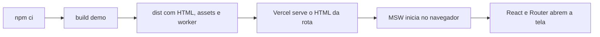

# 14. Build e publicação

Ao abrir `/nfts/exemplo` em outro navegador, a hospedagem recebe essa URL antes de o React existir na página. A publicação precisa entregar o HTML de entrada e deixar o TanStack Router interpretar a rota.

## Do código aos arquivos publicados

O Vite transforma TypeScript, JSX e CSS em arquivos que o navegador lê. O script `npm run build:demo` verifica tipos, gera `public/mockServiceWorker.js` com a versão instalada do MSW e produz `dist/` pelo modo `demo`. As imagens WebP importadas pelo código vão para o build. Hospedagem estática serve esses arquivos por HTTP. [Scripts npm](../../package.json) · [Vite](../../vite.config.ts)



## Variáveis e rotas

`VITE_ENABLE_MOCKS=true` em `.env.demo` ativa o mock no build. `VITE_API_BASE_URL` usa `/api` por padrão. O Vite incorpora essas configurações aos arquivos que qualquer visitante pode ler. Alterar a variável na hospedagem exige novo build. Use valores públicos e dados fictícios. [Modo demo](../../.env.demo) · [Leitura de variáveis](../../src/lib/env.ts)

O trecho abaixo faz parte do fallback da SPA. O padrão ignora API, assets, worker e caminho do Socket.IO. A rota de navegação recebe `index.html`, mantendo a URL para o Router. O worker responde no endereço próprio e tem política de revalidação. A conexão Socket.IO é interceptada pelo MSW na página publicada e usa `wss:` em HTTPS. [Configuração real](../../vercel.json) · [Guia oficial da Vercel](https://vercel.com/docs/frameworks/frontend/vite)

```json
{
  "source": "/((?!api(?:/|$)|assets(?:/|$)|kurio-realtime(?:/|$)|mockServiceWorker\\.js$).*)",
  "destination": "/index.html"
}
```

## Publicar e conferir

1. Gere e versione o lockfile com a instalação pública do npm. Valide `npm ci`, testes e build em um checkout limpo.
2. Importe o repositório em um projeto Vercel autorizado com Node 22 compatível ou 24. Confirme que a configuração executa `npm ci` e `npm run build:demo` e publica `dist/`. Mantenha a base REST em `/api`.
3. Abra a URL HTTPS em perfil novo. Confirme que `/mockServiceWorker.js` responde JavaScript, que os WebP aparecem e que o catálogo carrega. Abra e recarregue `/nfts/exemplo`. Abra uma rota privada deslogado e confirme o retorno após autenticar.
4. Execute a prova Socket.IO, percorra compra e conta, teste alterações de preço e estoque e recarregue um pedido. Registre commit, URL e evidências no README. A etapa local gerou a configuração. O deploy público está pendente. [Cenários](../scenarios.md) · [Eventos](../events.md)

Erros comuns são publicar o build sem modo demo, reescrever a URL do worker para HTML e usar caminho ou subdiretório diferente do configurado. Comece pela aba de rede e verifique status, tipo de conteúdo e origem.

## Exercícios

1. Compare o acesso direto a um detalhe com a navegação pelo card no preview. Identifique qual componente resolve a rota depois que o HTML chega.
2. Em um ambiente de teste autorizado, confira os tipos de conteúdo do worker, do HTML de detalhe e de um WebP no painel de rede.

## Perguntas de entrevista

1. **O que o build produz?** Arquivos estáticos de HTML, CSS, JavaScript, worker e assets prontos para a hospedagem.
2. **Por que uma SPA precisa de fallback?** O servidor recebe a URL inicial e precisa devolver o HTML para o roteador cliente interpretar o caminho.
3. **Por que separar os caminhos de assets?** O navegador espera cada tipo de arquivo no endereço correto. HTML no lugar de JS impede a execução.
4. **Onde os mocks executam após publicar?** No navegador, com MSW interceptando REST e WebSocket. A hospedagem serve os arquivos.
5. **Por que versionar o lockfile?** Ele registra o grafo resolvido e permite que `npm ci` instale as mesmas versões em outra máquina.
